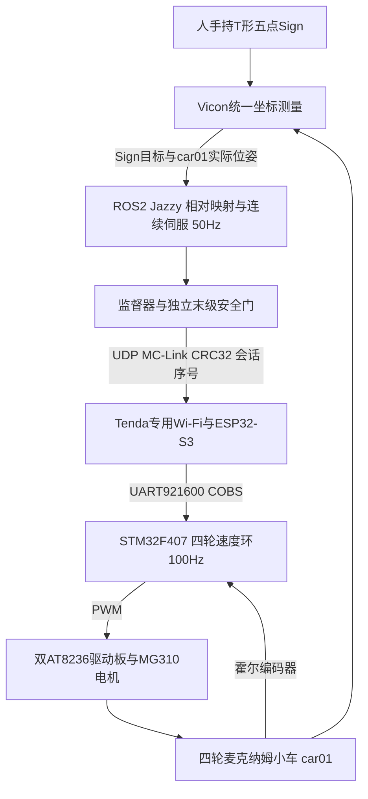

# ROS 2 麦克纳姆小车

## 2026年10月28日交付入口

本次收录小车工程源码、选定冻结运行时、离线回归与项目技术说明，不导出实时权限。
当前事实以[最新状态](../handoff/CAR_STATE_2026-10-28.json)为准。
本页后半段保留10月15日历史接线与早期版本资料，不能作为最新板内镜像判断。

[下载项目技术说明 Word](reports/2026-10-28/Vicon标定杆遥操作ROS全向小车项目技术说明.docx)
包含整体架构、7个可编辑公式、关键算法、5张汇总表及13项公开证据链接。
报告描述原项目成果；本次发布另补收4WSA600秒候选，资格见下表。

### 架构与Vicon的作用



Vicon同时测量操作杆和整车实际位姿：它既产生主操作器输入，又闭合车体位置外环。
编码器只能反馈轮子转动，Vicon则能观察打滑、侧移不足和被人为推离后的整车误差。
时间戳、遮挡与来源有效性参与安全门控；不存在用界面坐标替代实际定位的控制捷径。

相对位移采用1:1映射，启动时记录杆零点和车零点，Z不驱动平移。横杆为
Sign1—Sign5—Sign2，长柄为Sign3/4，车头正向背离长柄；水平相对yaw按1:1映射。
连续伺服用速度前馈和位置误差纠偏，减少重复位置滤波；候选通过共同缩放和耦合斜坡
保持XY与yaw的合成方向，避免逐轮不同步整形。轮速内环保留前馈、PI、抗饱和与故障停车。
历史矩形控制通过有向边投影、前视目标和受扰保持当前边实现回轨后继续运行。

### 已验证与待验证必须分开

|版本或能力|现有证据|边界|
|---|---|---|
|4WS8平移演示保存基线|真实Sign驱动实车约19.52秒，跟随、返回、停车接受|0.70m/s、0.80m/s²只是上限；非完整3×3m或带载测速认证|
|历史矩形和受扰回轨|独立历史版本完成循环及受扰恢复|不自动转移到后续全部固件|
|真实Sign驱动A2仿真|平移叠加旋转、换向和操作停止接受|软件车，不是高角速度实车验收；A2遮挡/恢复待验收|
|本机300ms启动修正版|前60秒无反馈超时，延长约98.6秒ROS保护停车|原入口120秒、yaw0.10rad/s与0.40rad/s²；长期稳定性未通过|
|ROS参考帧历史匹配候选|真实ROS节点的软件故障注入|尚未物理运动验收|
|浏览器快速只读端|本机Chrome严格60秒只读通过|Windows远程待验收；实车入口禁用|
|独立4WSA v6|600秒虚拟时限、630秒独立截止；主机与真实C报文测试通过|未刷写；未运行实车；新启动准入仍待接入|

4WSA档4保持平移0.70m/s、0.80m/s²，候选yaw上限1.50rad/s、6.00rad/s²。
档0至6不自动升档；最高档0.70m/s、2.00m/s²与yaw2.00rad/s、12.00rad/s²
没有实车资格。发布代码不等于600秒硬件能力已经可用。

现用后期演示按用户选择取消固定电子围栏，但保持定位、姿态、超时、来源、执行器
反馈及故障锁存保护。Vicon有效不等于周围无障碍；完整覆盖区域尚未测绘。
普通万用表只能初筛，不能认证瞬态电流、停车包络或温升。

### 代码目录和可复现命令

- `src/`：通用矩形/Vicon控制、初期标定杆控制和安全模块。
- `stm32/mecanum_f407/`：基础固件与独立候选叠层；HAL/CMSIS许可证保留。
- `esp32/mecanum_wifi_bridge/`：ESP-IDF通信桥；事件收发源另保存在对应冻结目录。
- `candidates/`：历次独立候选生成、预览、校验和回归源码，属于历史工程配方。
- `docs/.../prepared/runtime/src/`：本机300ms、ROS修复、4WS9/4WSA等选定冻结包。
- `docs/wand_servo_4ws8_2026-10-26/demo_3x3_20s/ready/runtime/src/`：保存演示源码。
- `reports/2026-10-28/`：公开版项目报告，证据链接不再依赖本机路径。

在仓库根目录运行：

```bash
bash scripts/doctor.sh
bash scripts/test_offline.sh
bash scripts/test_car_release.sh
python3 scripts/public_scan.py
```

后一个测试入口直接构建冻结C源码并验证导出的主机策略，不运行层叠历史生成器，
不初始化ROS图、不打开硬件端口。测试输出仅在`.local/`。

公开配置的现场确认已撤销，设备标识已合成，原始构建哈希清单和刷写记录未上传。
历史准备器引用的私有归档和原机路径不是完整的跨电脑构建依赖。它们用于源代码
审查与开发参考；不要批量运行`tools/start_*`或以旧哈希/许可开启实车。
4WSA增加了独立的可移植离线入口；其他历史端到端部署还需受控移植。

## 以下为10月15日历史资料

## 基线

STM32F407VGT6、4个MG310霍尔电机、两块D157B/AT8236、60mm麦轮、ESP32-S3 N16R8。
X排列：FL `\`、FR `/`、RL `/`、RR `\`；轴距122mm、轮距170mm均为近似轮心距离。
CPR近似值为 `[3179/3,1049,3167/3,1061]`，方向符号 `[+,-,+,-]`。
四个PI反馈独立，复用的是初始增益，不是已完成带载整定。

数据流：Vicon `car01` → ROS 2控制/安全监督 → UDP46000/46001 → ESP32 UART921600 → STM32。
MCU独立指令租约150ms、ESP会话750ms，断流锁停，重连不能恢复旧运动权限。

原电脑STM32板内：26988字节的**无PWM只读版**，SHA256：
`12d4224f5337b42d3bdc3eef30f4142e957d65d900d61b64d8b8fb22033e9aa6`。
最后停发后的超时是预期状态，无UART故障、PI禁用、PWM定时器关闭、8路控制脚低。
这是迁移前实测状态，不代表新电脑或重新上电后已经验证。

## 运动候选，不自动部署

`mecanum_f407_four_link_motion` 为独立、默认构建排除的4WM1目标：
支持流式速度、同向更新、换向前全停及500ms实测静止。每次最多120秒，PWM≤10%，
轮缘≤50mm/s、车体各轴≤50mm/s、yaw≤0.2rad/s；换向/零速不延长总期限。
故障锁存和一次额度保留。未在真实硬件执行，不能直接开启无限矩形循环。

显式主机 `bounded_motion_mode` 配合 `src/mecanum_vicon_control/config/bounded_motion.yaml`：
新HELLO后至少600ms禁用零速和新鲜4WM1静止反馈，再请求使能；还需要独立的安全使能。
实际收发、使能流程已做过ROS发送器→真实C状态机的内存联调；不是上电实测。

## 离线命令

从仓库根目录运行 `bash scripts/test_offline.sh car`。
ARM工具链在PATH后，可选：`bash scripts/build_car_stm32.sh`。该脚本只构建，不烧录。
ESP-IDF v6.1环境已激活且设置私密 `MC_AP_PASSWORD` 后，可选：
`bash scripts/build_esp32_softap.sh`，只构建，不打开串口。

## 现有接线参考，不代表允许上电

- ESP GPIO17/TX→STM32 PD6/RX；GPIO18/RX←PD5/TX；公共GND，不并接电源输出。
- 第一板：FL Motor_A，PE5/PE6→AIN1/2，E1A/B→PB4/5；
  FR Motor_B，PE9/PE11→BIN1/2，E2A/B→PB6/7。
- 第二板：RL Motor_A，PE13/PE14→AIN1/2，E1A/B→PA15/PB3(SWO)；
  RR Motor_B，PB14/15→BIN1/2，E2A/B→PC6/7。
- 原异常左后六芯线停用；不能因换电脑省略现场接线/供电确认。

## 真实Vicon进度

实际话题 `/vicon/car01/car01`，世界坐标`map`，单位米。
手推421.5mm时yaw变化1.26°，位移与临时显示车头差4.62°；左转得到+91.08°。
遮挡后有效标志失效1.924s，期间无车体位姿，恢复后数据有效；全程没有控制发布者。
不同窗口订阅约154–330Hz，时间戳年龄不是曝光端到端延迟或绝对精度证明。
临时+135°只用于显示，车体中心和精确车头偏移仍待标定。

下一步：充电后现场验证车载逻辑供电，确认后备份/烧录候选、无动力检查、悬空及低速落地。
不重复已有轮向/CPR实验，除非硬件、线束或配置确实变化。
