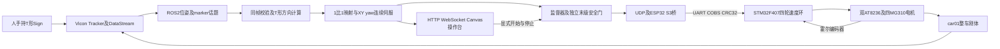

# Vicon标定杆遥操作ROS2全向小车技术说明

更新日期：2026年11月3日。系统将Vicon同时作为主操作器测量端和机器人外部定位端，
把手持T形标定杆的位移与水平转角映射为麦克纳姆小车的平移、旋转目标。
实车已完成1:1平移叠加旋转跟随的短时验收；最新600秒静止耐久结果属于软件链路测试。

## 项目意义

本项目把动捕从“显示机器人在哪里”转化为“实时产生目标并参与闭环控制”。
Vicon为Sign与car01提供统一世界坐标中的位置和姿态，使主从运动映射、轨迹误差计算、
外部扰动后的回轨控制具有共同测量基准。轮编码器反馈电机转速，Vicon反馈整车实际运动，
二者分别承担轮速内环和位置外环，能区分“轮子在转”与“车体确实到位”。

这是一套动捕与机器人控制集成的可演示原型，而不是通用避障系统。对于已有专业机器人
平台的客户，可保留Vicon采集、坐标映射和ROS接口，替换底盘执行层；替换后的安全和性能需重新验证。

## 整体架构

| 层次 | 技术与职责 |
| --- | --- |
| 测量 | Vicon Tracker、DataStream SDK、ROS2接收器；刚体6DoF与五点几何 |
| 算法 | Python/NumPy；世界与车体坐标转换、相对映射、连续角展开、前馈＋反馈 |
| 通信 | ROS2 Jazzy/DDS、受控UDP、ESP32-S3、UART921600、COBS与CRC32 |
| 执行 | STM32F407、C、100Hz四轮速度闭环、PI及抗饱和、PWM |
| 操作 | JavaScript、Canvas、WebSocket、后台有界会话；世界原点网格与朝向显示 |
| 工程验证 | pytest/unittest、原生C ASan/UBSan、独立ROS域、故障注入、源码摘要及读回核对 |

## 坐标映射和关键算法

### T形方向与相对映射

最新Sign刚体横杆为Sign1—Sign4—Sign3，长柄为Sign2/Sign5。三点共线性、
横杆宽度、长柄相对方向及全部点的同帧一致性用于验证几何；正向指向横杆外侧、背离长柄。
通过刚体旋转矩阵将局部正向变换至世界坐标，投影至水平面求yaw，避免把抬杆或翻腕直接当作平移指令。
编号属于刚体定义，重建刚体后必须复核，不能沿用旧Sign1—Sign5—Sign2编号。

在首次使能的零速阶段记录车与杆的参考位姿。当前1:1映射在共同世界坐标下可写为：

$$p_d^{xy}(t)=p_{car,0}^{xy}+[p_{Sign}^{xy}(t)-p_{Sign,0}^{xy}]$$

$$\psi_d(t)=\psi_{car,0}+\operatorname{unwrap}[\psi_{Sign}(t)-\psi_{Sign,0}]$$

目标高度保持车体参考高度；Sign的Z不映射为车体移动。杆收回时目标回到启动位置，
转回时目标回到启动朝向。首次使能前的拿起、调整杆不会变成历史积累运动。

### 连续伺服与麦克纳姆轮约束

位置误差转到车体坐标，短时间戳历史估计杆的速度与角速度，采用
`v*=v_ff+Kp·e`、`ω*=ω_ff+Kψ·eψ`，再施加运动约束。
当前直接目标版本不增加“绿色中间目标”，避免目标平滑与输出斜坡反复串联造成滞后。

平移与旋转通过麦克纳姆逆运动学转换为四轮目标。轮速超限时共同缩放XY与yaw，
再对合成车体命令做一次耦合加速度限制，保持合成方向；STM32执行独立轮速闭环，
并保留异常、堵转、编码器及失联停车保护。具体轮序与符号以源码和实车安装为准。

历史矩形演示是独立控制任务：通过边段投影、前视目标和当前边状态保持，实现受扰后回轨并继续循环，
不将其自动等同于所有后续固件的验证结果。自适应无级加速另有独立候选，尚不是实车正式基线。

### 软件调度与后台演示

浏览器仅绘制最新状态，后台独立执行有时限的操作会话。已启动后切换应用、最小化或暂停绘图
不再直接结束会话；关闭、刷新、通信断开、故障和到时仍停车。Esc仅在接收按键的页面生效，
后台另提供只执行停止的本机命令，不能把网页快捷键当作全局急停。

最新数据源修复采用有界同帧队列、分批消化回调、不可变几何缓存及独立来源身份检查，
避免DDS图查询阻塞控制执行。静止但具有新时间戳的位姿持续有效；重复旧帧不能续期，
未选中的过期输入丢弃，已绑定控制帧仍受原超时限制。

## Vicon延迟的解释边界

Vicon到ROS涉及相机采集、重建与刚体解算、DataStream传输和ROS接收发布。
ROS消息时间戳年龄取决于时间戳位置与时钟关系，不能直接作为“曝光到车轮”的物理延迟。
控制发布、末级门、桥接和显示有同序号软件计时基础，但还没有可对外承诺的统一物理端到端延迟值。
600秒测试中的最大控制间隔是调度指标，不是Vicon延迟或硬实时保证。

## 已完成成果与验收层次

| 内容 | 已有结果 | 适用范围 |
| --- | --- | --- |
| 矩形循环与人为干扰回轨 | 历史实车演示获操作者接受 | 独立历史版本 |
| Sign平移叠加旋转跟随 | 4WSC档6约60.008秒跟随及定时停车，操作者接受 | 配置0.70m/s、2.00m/s²、2.00rad/s、12.00rad/s²；非实测峰值认证 |
| STOPFIX固件部署 | 完整备份与独立读回核对记录；正常控制15,000个合成tick等价比较通过 | 读回证明写入一致，不证明实车全部动态性能 |
| 真实Sign驱动软件车 | 快速往返、换向、旋转、停止及既有遮挡恢复流程验收 | 仿真证据，不代替真机 |
| 后台独立浏览器版本 | 11组浏览器＋ROS＋原生C回环案例与65项准入测试通过 | 已保存版本的软件资格；不是最新版全套资格 |
| 最新静止数据源修复 | 600.003秒实际ROS节点＋原生C回环；27项单元测试通过 | 合成Vicon输入、无物理输出；包含120ms输入处理停顿 |
| 全覆盖、长时实车与电气性能 | 仍待完成 | 不能写成已完成10分钟实车稳定演示或已认证高速能力 |

最新600秒结果见[公开测试摘要](evidence/STATIC_600S.json)：59,746条主链路记录，
控制循环最大间隔约37.18ms，结束确认零输出。历史实车长流程曾约275秒和206秒保护停车，
与Sign绑定数据过期有关；最新修复尚需完整资格及现场长时复验，不能隐去这些边界。

## 后续验证

先完成最新数据源候选的浏览器及故障注入全套资格，再验证真实Tracker持续输出和实车600秒。
停车包络、瞬态电流、驱动板及电机温升、实际覆盖区域与物理端点延迟分别测量。
Vicon可见不等于周围无障碍，取消固定电子围栏不代表可无监护运行。

## 源码与复现

[源码索引](../../snapshots/2026-11-03/README.md)、
[状态交接](../../../handoff/CAR_STATE_2026-11-03.json)、
[本次公开验证](../../../handoff/CAR_VALIDATION_2026-11-03.json)。
10月28日Word报告保留为历史版本，不用其旧编号和状态覆盖本说明。
